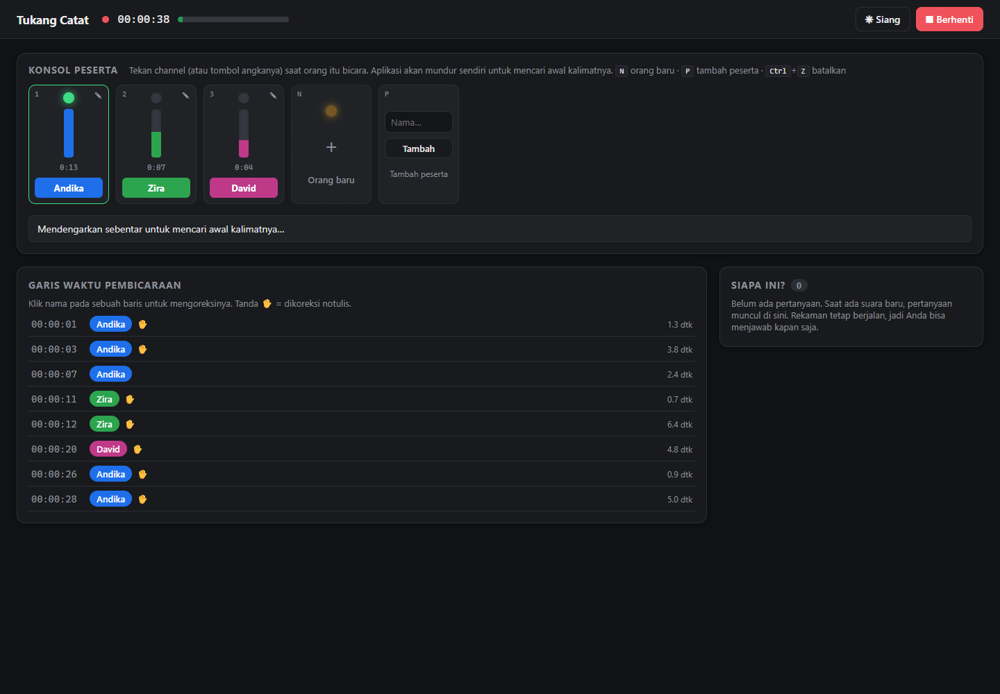

# Tukang Catat

Aplikasi pencatat notula rapat yang cerdas, gratis, dan berjalan **offline di komputer sendiri**.

Tukang Catat merekam rapat, mengenali **siapa yang sedang berbicara** dengan bantuan pencatat notula (manusia), lalu menghasilkan **transkrip berlabel pembicara**. Transkrip ini kemudian diolah menjadi notula rapat yang rapi menggunakan Claude dan *skill* khusus "Penulis Notula".

> Status: **prototipe v0.1**. Perekaman, pengenalan pembicara, dan transkripsi sudah berjalan. Skill "Penulis Notula" untuk Claude menyusul.

---

## Cara kerja

```
┌───────────────────────── SAAT RAPAT (real-time) ──────────────────────────┐
│  [Rekam] → deteksi suara → kenali sidik suara pembicara                   │
│     ├─ suara sudah dikenal  → dilabeli otomatis                           │
│     └─ suara baru           → pencatat ditanya: "Siapa ini?"              │
│                               (tidak ditanya dua kali untuk orang sama)   │
└───────────────────────────────────────────────────────────────────────────┘
                                     ↓
┌───────────────────────── SETELAH RAPAT ───────────────────────────────────┐
│  Whisper mentranskripsi per giliran bicara (bahasa dideteksi per giliran) │
│  → transkrip berlabel pembicara + waktu (.md / .json)                     │
└───────────────────────────────────────────────────────────────────────────┘
                                     ↓
┌───────────────────────── PENULISAN NOTULA (terpisah) ─────────────────────┐
│  Transkrip → Claude + skill "Penulis Notula" → notula rapat final         │
└───────────────────────────────────────────────────────────────────────────┘
```

### Prinsip desain
- **Gratis**: semua komponen open source. Penulisan notula memakai langganan Claude yang sudah ada, bukan API berbayar.
- **Privat**: audio dan transkrip tidak pernah meninggalkan komputer. Server hanya mendengarkan di `127.0.0.1`.
- **Manusia tetap memegang kendali**: mesin membedakan suara, manusia memberi nama.
- **Lintas platform**: aplikasi web lokal (server Python kecil + tampilan di browser), jadi bisa jalan di Windows, macOS, dan Linux.

## Instalasi

Butuh **Python 3.10+**. Periksa dulu kesiapan komputer:

```bash
python tools/cek_hardware.py
```

Lalu pasang:

```bash
python -m venv .venv
# Windows:
.venv\Scripts\activate
# macOS / Linux:
source .venv/bin/activate

pip install -r requirements.txt
python tools/unduh_model.py        # model deteksi suara & sidik suara (~27 MB)
```

Model Whisper (ratusan MB sampai ~3 GB) diunduh otomatis saat transkripsi pertama.

## Pemakaian

**Windows:** klik dua kali **`Jalankan Tukang Catat.bat`** di folder proyek. Saat pertama kali, file ini juga memasang semua kebutuhan.

Atau lewat terminal, dari dalam folder proyek:

```bash
python run.py
```

Browser terbuka di `http://127.0.0.1:8765`.



1. **Persiapan.** Isi judul rapat dan (opsional) daftar peserta, lalu klik **Mulai Rekam**. Izinkan akses mikrofon.
2. **Saat rapat: konsol peserta.** Cara kerjanya mirip mengoperasikan mixer FOH. Setiap peserta adalah satu *channel strip* dengan lampu LED, meter waktu bicara, dan nama.
   - **LED hijau** menyala pada channel yang menurut aplikasi sedang bicara.
   - **Tekan channel seseorang** (atau tombol angkanya, `1`–`9`) saat dia bicara, kalau aplikasi keliru atau ragu. Channel berkedip kuning, lalu aplikasi **mendengarkan ~2 detik lagi dan mundur sendiri** (sampai 20 detik) untuk mencari awal kalimat orang itu. Jadi terlambat menekan beberapa detik tidak masalah.
   - Channel yang ditekan **tetap terbuka**: kalimat berikutnya tetap milik orang itu, kecuali ada suara lain yang jelas berbeda. Ini sangat membantu untuk audio lewat speaker (TV, peserta Zoom), di mana suara semua orang terdengar mirip.
   - **Orang baru** (`N`): ada yang bicara tapi belum punya channel. Aplikasi mencari awal suaranya dan memunculkan kartu **"Siapa ini?"**.
   - **Tambah peserta** (`P`): peserta yang datang terlambat atau belum terdaftar.
   - **Batalkan** (`Ctrl`+`Z`): membatalkan koreksi terakhir.
   - Aplikasi **belajar dari setiap koreksi**: sidik suara orang itu diperbarui dari potongan yang Anda tetapkan.
   - Kartu **"Siapa ini?"** tetap muncul untuk suara baru yang terdeteksi otomatis. Orang yang sama tidak ditanya lagi. Jika ternyata orang yang sudah dikenal, pilih namanya: keduanya digabung.
   - Klik nama pada garis waktu untuk mengoreksi satu potongan (tanda ✋ = dikoreksi notulis).
3. **Setelah rapat.** Klik **Berhenti**, pilih model Whisper, lalu **Mulai Transkripsi**.
4. Unduh atau salin `transkrip.md`, lalu berikan ke Claude untuk dibuatkan notula.

Tombol **☾ Malam / ☀ Siang** di kanan atas mengganti tema tampilan. Pilihan Anda diingat browser.

Semua data tersimpan di `recordings/<tanggal-jam>/` (`audio.wav`, `session.json`, `transkrip.md`, `transkrip.json`). Folder ini tidak ikut ter-commit ke git.

Transkripsi juga bisa dijalankan ulang dari terminal, misalnya dengan model lain:

```bash
python -m tukang_catat.transcribe recordings/20261125-140000 --model large-v3-turbo
```

### Mengatur kepekaan pembeda suara
Slider **Kepekaan pembeda suara** (default 0.65) menentukan seberapa mirip dua suara agar dianggap orang yang sama.
- **Terlalu sering bertanya** untuk orang yang sama? Turunkan.
- **Dua orang berbeda tergabung** jadi satu? Naikkan.

Lebih baik sedikit terlalu sering bertanya, karena itu mudah dikoreksi dengan memilih nama yang sudah ada. Sebaliknya, dua orang yang tergabung diam-diam tidak terlihat.

## Teknologi

| Fungsi | Teknologi |
|---|---|
| Deteksi suara (VAD) | Silero VAD via sherpa-onnx |
| Sidik suara pembicara | WeSpeaker ResNet34 (VoxCeleb) via sherpa-onnx |
| Speech-to-text | faster-whisper |
| Server lokal | FastAPI + WebSocket |
| Tampilan | HTML/JS biasa (tanpa build), AudioWorklet untuk mikrofon |

## Kebutuhan hardware

| Tingkat | Spesifikasi | Model Whisper |
|---|---|---|
| Minimum | CPU 4 core, RAM 8 GB | `small` |
| Direkomendasikan | CPU 8+ core, RAM 16 GB | `large-v3-turbo` (~30 mnt per 1 jam rapat) |
| Optimal | GPU NVIDIA dengan VRAM 6 GB+ | `large-v3` |

Penjelasan lengkap, termasuk catatan untuk Mac: **[docs/KEBUTUHAN-HARDWARE.md](docs/KEBUTUHAN-HARDWARE.md)**.

## Keterbatasan prototipe
- **Audio lewat speaker** (TV, rekaman, peserta Zoom dari speaker laptop) membuat suara semua orang terdengar mirip, karena "jalur" suaranya sama. Pengenalan otomatis jadi lemah, dan di kondisi ini notulis perlu aktif menekan channel. Pada simulasi kondisi TV, ketepatan label naik dari 47% (otomatis) menjadi 76–93% dengan notulis yang menekan channel 1–5 detik terlambat.
- Dua orang yang bicara **bersamaan** dilabeli sebagai salah satu dari mereka.
- Ucapan sangat pendek (di bawah ~1,5 detik) dari suara yang belum dikenal dilabeli `?`. Label ini dicocokkan ulang otomatis setelah orangnya dikenali.
- Pergantian pembicara tanpa jeda sama sekali bisa masuk ke satu potongan, kecuali notulis menekan channel (potongan akan dibelah di titik pergantian).
- Ambang kepekaan default belum dikalibrasi dengan rekaman rapat sungguhan.

## Pengembangan

```bash
python -m unittest discover tests
```

## Struktur repo

```
tukang-catat/
├── run.py                     # jalankan aplikasi
├── requirements.txt
├── tukang_catat/
│   ├── app.py                 # server FastAPI + WebSocket
│   ├── session.py             # sesi rekaman: VAD, sidik suara, penyimpanan
│   ├── speakers.py            # logika "kenali / tanya sekali"
│   ├── transcribe.py          # transkripsi Whisper per giliran bicara
│   └── web/                   # tampilan (HTML/CSS/JS)
├── tools/
│   ├── cek_hardware.py        # cek kesiapan komputer
│   └── unduh_model.py         # unduh model ONNX
├── tests/
└── docs/
    └── KEBUTUHAN-HARDWARE.md
```

## Lisensi

[MIT](LICENSE)
